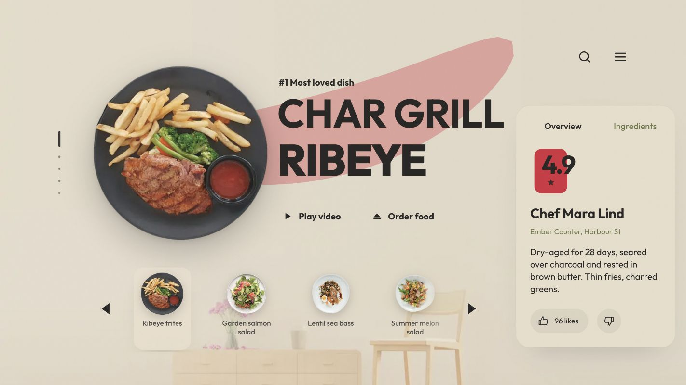
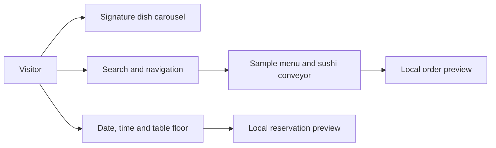

# Moonlight Café

A Japanese dining and sushi-bar website concept combining a rotating signature-dish menu, an interactive kaiten belt, and a table-floor reservation preview.

## Design direction

The visual system keeps its sand and oat surfaces, rounded controls, and restrained grain texture, with bold black typography and cherry-red accents. Its signature interaction is the featured dish orbit, paired with a separate moving sushi belt.

## The four design prompts

These are the four supplied component briefs used to shape the site. The integrated React components are in `src/components/ui/`.

### 1. Table booking design

Integrate the supplied `pk-table-floor.tsx` React component into the existing shadcn-compatible, Tailwind CSS, TypeScript project. Provide selectable tables, sample availability by time, party-size controls, joined neighboring tables, and an accessible responsive floor plan. Use a local confirmation preview; do not imply that a real reservation has been sent.

### 2. Home-page hero section

Use the supplied `dish-orbit-carousel.tsx` as the home-page hero, matching its light dining-room backdrop, orbiting plated dishes, two-weight title, rating card, ingredient tabs, dish thumbnails, and navigation controls. Keep the reservation link and preserve the separate menu and reservation sections below. The supplied `shadcn-studio-hero-section-41.tsx` slideshow and the separate “Signatures, in season.” menu heading are not part of this hero.

### 3. Menu section

Keep the moving kaiten conveyor as the separate menu showcase, with sample dishes and prices clearly identified as illustrative.

### 4. Main restaurant design

Use the supplied `sushi-conveyor-menu.tsx` as a separate kaiten-sushi showcase. Include a moving plate belt, plate details, a price-tier legend, pause/navigation controls, and an order preview that does not submit a real food order.

## Run locally

```sh
npm install
npm run dev
```

## Reservation and menu previews

The floor plan, booked time slots, menu, prices, carousel dishes, ratings, chef details, and likes are illustrative sample data. The table selector displays a local preview only; it does not check live availability or submit a booking. Adding a dish updates a local order-preview message only; it does not send an order.

Restaurant and sushi photography is bundled locally in `public/images/`. The source photographs are from Unsplash; the plate cutouts are from the supplied sushi component reference.

## Build and lint

```sh
npm run build
npm run lint
```

## Interface and flow





Order and reservation previews are illustrative and do not send data to a restaurant.
